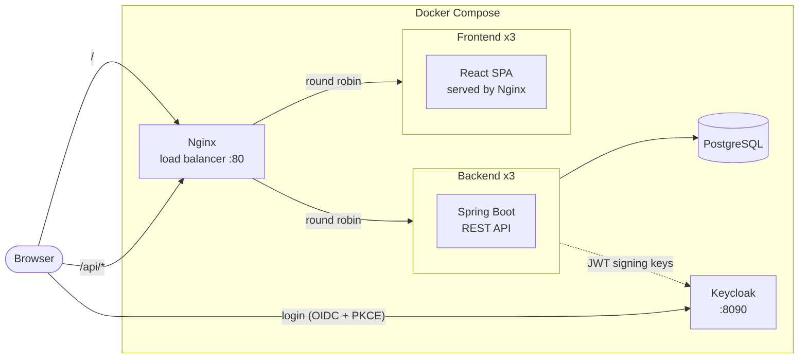
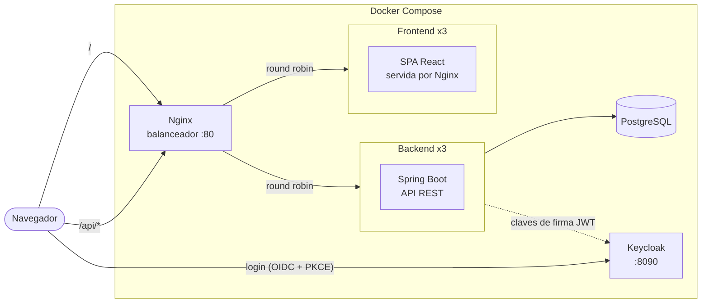

# ToolRent

> 🇪🇸 [Versión en español más abajo](#toolrent-español)

**Tool rental management system** for a store that lends tools for construction, repairs and home projects.
It replaces spreadsheets and paper records with a web application that controls the inventory in real time,
applies the rental rules automatically (limits, late fees, damage charges), keeps an auditable record of every
stock movement and produces management reports.

Full-stack web application: **React** frontend, **Spring Boot** REST API with a layered architecture,
**PostgreSQL**, **Keycloak** for identity and access management, deployed with **Docker Compose** behind an
**Nginx** load balancer and built by a **Jenkins** CI/CD pipeline.

---

## Contents

- [Features](#features)
- [Architecture](#architecture)
- [Tech stack](#tech-stack)
- [Getting started](#getting-started)
- [Local development](#local-development)
- [Testing and quality](#testing-and-quality)
- [CI/CD pipeline](#cicd-pipeline)
- [REST API](#rest-api)
- [Configuration](#configuration)
- [Project structure](#project-structure)
- [Known limitations](#known-limitations)

---

## Features

Two roles, managed in Keycloak: **Administrator** (full access) and **Employee** (loans, returns and reports).

| Module | What it does | Role |
|---|---|---|
| **Inventory** | Register tools (name, category, stock, replacement value); adjust stock; decommission tools; evaluate damaged units (*repaired* back to stock, or *irreparable* and written off). The status is derived from unit counters: available, loaned, under repair, decommissioned. | Admin |
| **Loans and returns** | Register a loan with start and due date after validating every business rule; register returns in good condition, with light damage or with irreparable damage; compute the amount due automatically; mark debts as paid. | Admin, Employee |
| **Clients** | Register clients (validated Chilean RUT, phone, email), edit their data, restrict them or reactivate them once their debts are settled. | Admin (employees can read) |
| **Tariffs** | Configure the daily rental fee, the daily late fee and the light-damage repair fee. | Admin |
| **Kardex** | Automatic audit trail of every inventory movement (income, loan, return, repair, repaired, decommission, manual decrease) with date, user and quantity; query by tool or by date range. | Admin |
| **Reports** | Active and late loans, clients with late loans, ranking of the most loaned tools; optional date range filter. | Admin, Employee |
| **Users and roles** | Login with username and password through Keycloak (OIDC + PKCE); authorization by role in both the API and the UI. | — |

### Business rules enforced by the backend

- A loan requires an **active** client without late loans, overdue loans or unpaid debts, and an available tool with stock.
- A client can have at most **5 open loans** and cannot have the same tool twice at the same time.
- The due date cannot be before the start date; a loan cannot be modified once registered.
- **Amount due** = rental days × daily fee (minimum 1 day, no refunds for early returns)
  \+ days late × daily late fee
  \+ repair fee (light damage) **or** replacement value (irreparable damage).
- An hourly job marks overdue loans as **late** and restricts their clients; a returned loan keeps the client
  restricted until the debt is paid.
- Every loan and return records the **responsible user and timestamp**; every stock change creates a Kardex movement.

---

## Architecture



- The browser logs in against **Keycloak** and sends the access token (JWT) with every API call.
- **Nginx** is the single entry point: `/` goes to one of the three frontend replicas and `/api/*` to one of the
  three backend replicas (the `X-Upstream` response header shows which one answered).
- Each backend replica is a stateless **OAuth2 resource server**: it validates the JWT signature with Keycloak's
  public keys and maps the realm roles (`ADMIN`, `EMPLOYEE`) to authorities.
- `backend-1` creates the schema and loads the seed data; the other replicas start once it is healthy.

### Backend layers

```
controllers  →  services  →  repositories  →  entities
(HTTP, DTOs)    (business     (Spring Data      (JPA)
                 rules)        JPA)
```

Cross-cutting concerns live in `app/`: security configuration, Keycloak role mapping, the global exception
handler (consistent JSON errors: `{status, error, message, fieldErrors}`) and the resolution of the
authenticated user.

---

## Tech stack

| Layer | Technology |
|---|---|
| Frontend | React 19, Vite 7, React Router 7, Axios, keycloak-js 26 |
| Backend | Java 21, Spring Boot 4.1 (Spring MVC, Spring Data JPA / Hibernate 7, Bean Validation, Spring Security 7 OAuth2 Resource Server, Actuator), Lombok |
| Database | PostgreSQL 15 |
| Identity and access | Keycloak 24 (realm imported on startup) |
| Infrastructure | Docker, Docker Compose, Nginx |
| CI/CD | Jenkins (pipeline as code), Docker Hub |
| Testing | JUnit 6, Mockito 5, Spring MockMvc, Spring Security Test, JaCoCo |

---

## Getting started

**Requirements:** Docker Desktop (or Docker Engine with Compose v2). Ports **80**, **5433** and **8090** must be free.

```bash
git clone https://github.com/HIN0/Tingeso_Entrega_1.git
cd Tingeso_Entrega_1
cp .env.example .env        # Windows PowerShell: Copy-Item .env.example .env
docker compose pull
docker compose up -d
```

Database and Keycloak admin credentials are read from `.env`, which is ignored by Git; [`.env.example`](.env.example)
is the template with local demo values. Compose refuses to start if a variable is missing.

The first start takes about a minute (Keycloak and the backend replicas start in order). Then open:

| URL | Service |
|---|---|
| http://localhost | ToolRent |
| http://localhost:8090 | Keycloak admin console (user and password from `.env`) |

**Demo users** (defined in [`keycloak-data/realm-export.json`](keycloak-data/realm-export.json)):

| User | Password | Role |
|---|---|---|
| `diego` | `diego123` | Administrator |
| `juan` | `juan123` | Employee |

> These users exist only for local demos. Remove them from the realm, and set strong passwords in `.env`, before
> exposing the application anywhere.

The database is seeded with 20 clients, 30 tools and sample loans (active, late, and returned with pending payment). To start again from a clean
database: `docker compose down -v && docker compose up -d`.

---

## Local development

Start only the infrastructure in Docker and run the applications from the IDE:

```bash
docker compose up -d db keycloak
```

**Backend** (http://localhost:8080):

```bash
cd BackCore
# The compose database is published on port 5433
DB_URL=jdbc:postgresql://localhost:5433/toolrent ./mvnw spring-boot:run
```

On Windows PowerShell: `$env:DB_URL="jdbc:postgresql://localhost:5433/toolrent"; .\mvnw.cmd spring-boot:run`

**Frontend** (http://localhost:5173, proxies `/api` to the backend):

```bash
cd CoreBack-frontend
npm install
npm run dev
```

---

## Testing and quality

```bash
cd BackCore
./mvnw test
```

**166 tests**, three kinds:

| Kind | Classes | What they cover |
|---|---|---|
| Unit (Mockito) | `*ServiceTest`, `RutValidatorTest` | Business rules of every service: loan validations, fee calculation, stock and status transitions, reactivation, reports, RUT check digit |
| Web layer (`@WebMvcTest`) | `WebLayerTest` | Real controllers, security and exception handler with simulated JWT users: 401/403 per role, 400 with field errors, 404/405, no internal details on 500, no mass assignment, password never serialized |
| Service validation | `ServiceValidationTest` | Services behind Spring's method-validation proxy, which unit tests bypass |

**Quality gate:** JaCoCo fails the build if line coverage of the business layer (`services`) drops below **90%**
(currently **98.6%**). Report: `BackCore/target/site/jacoco/index.html`.

Frontend: `npm run lint` (ESLint, 0 problems) and `npm audit` (0 known vulnerabilities).

---

## CI/CD pipeline

The [`Jenkinsfile`](Jenkinsfile) defines the pipeline:

```
Checkout (GitHub) → Test backend (JUnit + JaCoCo gate) → Build & push backend image → Build & push frontend image
```

Images are published to Docker Hub as `izkybin/toolrent-backend` and `izkybin/toolrent-frontend`, tagged with the
**build number** (traceable, allows rollback) and **`latest`** (used by `compose.yml`). A failing test or a coverage
drop stops the pipeline before anything is published.

A ready-to-use Jenkins (JDK 21, Docker CLI and the required plugins) runs locally with
`docker compose -f jenkins/compose.yml up -d --build`; setup steps in [`jenkins/README.md`](jenkins/README.md).

---

## REST API

All endpoints are under `/api` when accessed through Nginx and require a Keycloak access token
(`Authorization: Bearer <token>`), except `GET /actuator/health`.

| Resource | Endpoints | Roles |
|---|---|---|
| Tools | `GET /tools`, `GET /tools/{id}` | Admin, Employee |
| | `POST /tools`, `PUT /tools/{id}`, `PATCH /tools/{id}/stock`, `PATCH /tools/{id}/repair/complete`, `PATCH /tools/{id}/repair/write-off`, `PUT /tools/{id}/decommission` | Admin |
| Clients | `GET /clients`, `GET /clients/{id}` | Admin, Employee |
| | `POST /clients`, `PUT /clients/{id}`, `PATCH /clients/{id}/status`, `PATCH /clients/{id}/activate` | Admin |
| Loans | `GET /loans` (open loans), `GET /loans/{id}`, `GET /loans/client/{clientId}/unpaid`, `POST /loans`, `PUT /loans/{id}/return` | Admin, Employee |
| | `PATCH /loans/{id}/pay` | Admin |
| Tariffs | `GET /tariffs`, `PUT /tariffs` | Admin |
| Kardex | `GET /kardex/tool/{toolId}`, `GET /kardex/date?start=&end=` | Admin |
| Reports | `GET /reports/loans?status=&from=&to=`, `GET /reports/clients/late?from=&to=`, `GET /reports/tools/top?from=&to=` | Admin, Employee |
| Users | `GET /users/{username}`, `POST /users` | Admin |

Errors always use the same JSON shape, for example:

```json
{ "status": 400, "error": "Bad Request", "message": "Validation failed. Check 'fieldErrors'.",
  "fieldErrors": { "email": "Invalid email format" } }
```

---

## Configuration

Backend environment variables (defaults target a local run against the compose infrastructure):

| Variable | Default | Purpose |
|---|---|---|
| `DB_URL` | `jdbc:postgresql://localhost:5432/toolrent` | JDBC URL |
| `DB_USERNAME` / `DB_PASSWORD` | `postgres` / `postgres` | Database credentials |
| `DDL_AUTO` | `update` | Hibernate schema management |
| `SQL_INIT_MODE` | `always` | Load `data.sql` (it only inserts into empty tables) |
| `KEYCLOAK_ISSUER_URI` | `http://localhost:8090/realms/toolrent-realm` | Expected `iss` claim (URL used by the browser) |
| `KEYCLOAK_JWK_SET_URI` | `http://localhost:8090/realms/toolrent-realm/protocol/openid-connect/certs` | Signing keys (URL reachable by the backend) |

In Docker Compose, `DB_USERNAME`, `DB_PASSWORD`, `KEYCLOAK_ADMIN` and `KEYCLOAK_ADMIN_PASSWORD` come from `.env`.

Frontend build-time variables are documented in [`CoreBack-frontend/README.md`](CoreBack-frontend/README.md).

---

## Project structure

```
.
├── BackCore/                Spring Boot REST API
│   └── src/main/java/
│       ├── app/             bootstrap, security config, Keycloak role converter, error handler
│       ├── controllers/     REST endpoints
│       ├── services/        business rules
│       ├── repositories/    Spring Data JPA repositories
│       ├── entities/        JPA entities and enums
│       └── dtos/            request bodies with validation
├── CoreBack-frontend/       React SPA (Vite)
├── keycloak-data/           Keycloak realm: roles, client and demo users
├── nginx/                   load balancer configuration
├── jenkins/                 local Jenkins image and setup guide
├── compose.yml              full deployment (9 containers)
└── Jenkinsfile              CI/CD pipeline
```

---

## Known limitations

- **Local deployment only:** HTTP without TLS, demo users in the Keycloak realm file, Keycloak in development mode
  (`start-dev`) and Jenkins running as root to use the Docker socket.
- **Keycloak 24** is behind the current release and should be upgraded together with a production setup
  (`start` mode, its own database, HTTPS).
- Tools are tracked as **types with unit counters**, not as individual serial-numbered units, so the history of a
  single physical unit is not available.
- The backend packages use short top-level names (`app`, `services`, ...) instead of a reverse-domain base package.
- No end-to-end browser tests; the web layer is covered with MockMvc.

---

*Academic project for the course* Métodos y Técnicas de Ingeniería de Software.

<br>

---
---

# ToolRent (español)

> 🇬🇧 [English version above](#toolrent)

**Sistema de gestión de arriendo de herramientas** para una tienda que presta herramientas para construcción,
reparaciones y proyectos del hogar. Reemplaza planillas y registros en papel por una aplicación web que controla
el inventario en tiempo real, aplica automáticamente las reglas de arriendo (límites, multas por atraso, cargos por
daño), mantiene un registro auditable de cada movimiento de stock y genera reportes de gestión.

Aplicación web full-stack: frontend en **React**, API REST en **Spring Boot** con arquitectura por capas,
**PostgreSQL**, **Keycloak** para la gestión de identidades y accesos, desplegada con **Docker Compose** detrás de
un balanceador de carga **Nginx** y construida por un pipeline CI/CD en **Jenkins**.

---

## Contenido

- [Funcionalidades](#funcionalidades)
- [Arquitectura](#arquitectura)
- [Tecnologías](#tecnologías)
- [Puesta en marcha](#puesta-en-marcha)
- [Desarrollo local](#desarrollo-local)
- [Pruebas y calidad](#pruebas-y-calidad)
- [Pipeline CI/CD](#pipeline-cicd)
- [API REST](#api-rest)
- [Configuración](#configuración)
- [Estructura del proyecto](#estructura-del-proyecto)
- [Limitaciones conocidas](#limitaciones-conocidas)

---

## Funcionalidades

Dos roles, gestionados en Keycloak: **Administrador** (acceso total) y **Empleado** (préstamos, devoluciones y reportes).

| Módulo | Qué hace | Rol |
|---|---|---|
| **Inventario** | Registrar herramientas (nombre, categoría, stock, valor de reposición); ajustar stock; dar de baja herramientas; evaluar unidades dañadas (*reparada*, vuelve al stock, o *irreparable*, se da de baja). El estado se deriva de contadores de unidades: disponible, prestada, en reparación, dada de baja. | Admin |
| **Préstamos y devoluciones** | Registrar un préstamo con fecha de inicio y de devolución tras validar todas las reglas de negocio; registrar devoluciones en buen estado, con daño leve o con daño irreparable; calcular automáticamente el monto a pagar; marcar deudas como pagadas. | Admin, Empleado |
| **Clientes** | Registrar clientes (RUT chileno validado, teléfono, correo), editar sus datos, restringirlos o reactivarlos una vez saldadas sus deudas. | Admin (los empleados pueden consultar) |
| **Tarifas** | Configurar la tarifa diaria de arriendo, la multa diaria por atraso y el cargo de reparación por daño leve. | Admin |
| **Kardex** | Registro automático de cada movimiento de inventario (ingreso, préstamo, devolución, reparación, reparada, baja, disminución manual) con fecha, usuario y cantidad; consulta por herramienta o por rango de fechas. | Admin |
| **Reportes** | Préstamos activos y atrasados, clientes con préstamos atrasados, ranking de las herramientas más prestadas; filtro opcional por rango de fechas. | Admin, Empleado |
| **Usuarios y roles** | Inicio de sesión con usuario y contraseña a través de Keycloak (OIDC + PKCE); autorización por rol tanto en la API como en la interfaz. | — |

### Reglas de negocio que aplica el backend

- Un préstamo requiere un cliente **activo** sin préstamos atrasados, vencidos ni deudas impagas, y una herramienta disponible con stock.
- Un cliente puede tener como máximo **5 préstamos abiertos** y no puede tener la misma herramienta dos veces a la vez.
- La fecha de devolución no puede ser anterior a la de inicio; un préstamo no se puede modificar una vez registrado.
- **Monto a pagar** = días de arriendo × tarifa diaria (mínimo 1 día, sin reembolso por devolución anticipada)
  \+ días de atraso × multa diaria
  \+ cargo de reparación (daño leve) **o** valor de reposición (daño irreparable).
- Un proceso cada hora marca los préstamos vencidos como **atrasados** y restringe a sus clientes; un préstamo
  devuelto mantiene al cliente restringido hasta que pague la deuda.
- Cada préstamo y devolución registra el **usuario responsable y la fecha/hora**; cada cambio de stock genera un movimiento en el Kardex.

---

## Arquitectura



- El navegador inicia sesión en **Keycloak** y envía el token de acceso (JWT) en cada llamada a la API.
- **Nginx** es el único punto de entrada: `/` va a una de las tres réplicas del frontend y `/api/*` a una de las
  tres réplicas del backend (la cabecera de respuesta `X-Upstream` indica cuál respondió).
- Cada réplica del backend es un **servidor de recursos OAuth2** sin estado: valida la firma del JWT con las claves
  públicas de Keycloak y convierte los roles del realm (`ADMIN`, `EMPLOYEE`) en autoridades.
- `backend-1` crea el esquema y carga los datos iniciales; las demás réplicas arrancan cuando este está sano.

### Capas del backend

```
controllers  →  services  →  repositories  →  entities
(HTTP, DTOs)    (reglas de    (Spring Data      (JPA)
                 negocio)      JPA)
```

Los aspectos transversales están en `app/`: configuración de seguridad, mapeo de roles de Keycloak, el manejador
global de excepciones (errores JSON consistentes: `{status, error, message, fieldErrors}`) y la resolución del
usuario autenticado.

---

## Tecnologías

| Capa | Tecnología |
|---|---|
| Frontend | React 19, Vite 7, React Router 7, Axios, keycloak-js 26 |
| Backend | Java 21, Spring Boot 4.1 (Spring MVC, Spring Data JPA / Hibernate 7, Bean Validation, Spring Security 7 OAuth2 Resource Server, Actuator), Lombok |
| Base de datos | PostgreSQL 15 |
| Identidad y acceso | Keycloak 24 (realm importado al iniciar) |
| Infraestructura | Docker, Docker Compose, Nginx |
| CI/CD | Jenkins (pipeline como código), Docker Hub |
| Pruebas | JUnit 6, Mockito 5, Spring MockMvc, Spring Security Test, JaCoCo |

---

## Puesta en marcha

**Requisitos:** Docker Desktop (o Docker Engine con Compose v2). Los puertos **80**, **5433** y **8090** deben estar libres.

```bash
git clone https://github.com/HIN0/Tingeso_Entrega_1.git
cd Tingeso_Entrega_1
cp .env.example .env        # Windows PowerShell: Copy-Item .env.example .env
docker compose pull
docker compose up -d
```

Las credenciales de la base de datos y del administrador de Keycloak se leen desde `.env`, que Git ignora;
[`.env.example`](.env.example) es la plantilla con valores de demostración local. Compose no arranca si falta alguna variable.

El primer inicio tarda alrededor de un minuto (Keycloak y las réplicas del backend arrancan en orden). Luego abre:

| URL | Servicio |
|---|---|
| http://localhost | ToolRent |
| http://localhost:8090 | Consola de administración de Keycloak (usuario y contraseña de `.env`) |

**Usuarios de demostración** (definidos en [`keycloak-data/realm-export.json`](keycloak-data/realm-export.json)):

| Usuario | Contraseña | Rol |
|---|---|---|
| `diego` | `diego123` | Administrador |
| `juan` | `juan123` | Empleado |

> Estos usuarios existen solo para demostraciones locales. Elimínalos del realm y define contraseñas seguras en
> `.env` antes de exponer la aplicación.

La base de datos se carga con 20 clientes, 30 herramientas y préstamos de ejemplo (activos, atrasados y devueltos
con pago pendiente). Para empezar de nuevo con una base limpia: `docker compose down -v && docker compose up -d`.

---

## Desarrollo local

Levanta solo la infraestructura en Docker y ejecuta las aplicaciones desde el IDE:

```bash
docker compose up -d db keycloak
```

**Backend** (http://localhost:8080):

```bash
cd BackCore
# La base de datos de compose se publica en el puerto 5433
DB_URL=jdbc:postgresql://localhost:5433/toolrent ./mvnw spring-boot:run
```

En Windows PowerShell: `$env:DB_URL="jdbc:postgresql://localhost:5433/toolrent"; .\mvnw.cmd spring-boot:run`

**Frontend** (http://localhost:5173, redirige `/api` al backend):

```bash
cd CoreBack-frontend
npm install
npm run dev
```

---

## Pruebas y calidad

```bash
cd BackCore
./mvnw test
```

**166 pruebas**, de tres tipos:

| Tipo | Clases | Qué cubren |
|---|---|---|
| Unitarias (Mockito) | `*ServiceTest`, `RutValidatorTest` | Reglas de negocio de cada servicio: validaciones de préstamo, cálculo de montos, transiciones de stock y estado, reactivación, reportes, dígito verificador del RUT |
| Capa web (`@WebMvcTest`) | `WebLayerTest` | Controladores reales, seguridad y manejador de excepciones con usuarios JWT simulados: 401/403 por rol, 400 con errores por campo, 404/405, sin detalles internos en un 500, sin asignación masiva, contraseña nunca serializada |
| Validación de servicios | `ServiceValidationTest` | Servicios detrás del proxy de validación de métodos de Spring, que las pruebas unitarias no atraviesan |

**Umbral de calidad:** JaCoCo hace fallar el build si la cobertura de líneas de la capa de negocio (`services`)
baja del **90%** (actualmente **98,6%**). Reporte: `BackCore/target/site/jacoco/index.html`.

Frontend: `npm run lint` (ESLint, 0 problemas) y `npm audit` (0 vulnerabilidades conocidas).

---

## Pipeline CI/CD

El [`Jenkinsfile`](Jenkinsfile) define el pipeline:

```
Checkout (GitHub) → Pruebas backend (JUnit + umbral JaCoCo) → Build y push imagen backend → Build y push imagen frontend
```

Las imágenes se publican en Docker Hub como `izkybin/toolrent-backend` e `izkybin/toolrent-frontend`, etiquetadas
con el **número de build** (trazable, permite volver atrás) y **`latest`** (la que usa `compose.yml`). Una prueba
fallida o una baja de cobertura detiene el pipeline antes de publicar nada.

Un Jenkins listo para usar (JDK 21, Docker CLI y los plugins necesarios) se levanta localmente con
`docker compose -f jenkins/compose.yml up -d --build`; los pasos de configuración están en [`jenkins/README.md`](jenkins/README.md).

---

## API REST

Todos los endpoints están bajo `/api` cuando se accede a través de Nginx y requieren un token de acceso de Keycloak
(`Authorization: Bearer <token>`), excepto `GET /actuator/health`.

| Recurso | Endpoints | Roles |
|---|---|---|
| Herramientas | `GET /tools`, `GET /tools/{id}` | Admin, Empleado |
| | `POST /tools`, `PUT /tools/{id}`, `PATCH /tools/{id}/stock`, `PATCH /tools/{id}/repair/complete`, `PATCH /tools/{id}/repair/write-off`, `PUT /tools/{id}/decommission` | Admin |
| Clientes | `GET /clients`, `GET /clients/{id}` | Admin, Empleado |
| | `POST /clients`, `PUT /clients/{id}`, `PATCH /clients/{id}/status`, `PATCH /clients/{id}/activate` | Admin |
| Préstamos | `GET /loans` (préstamos abiertos), `GET /loans/{id}`, `GET /loans/client/{clientId}/unpaid`, `POST /loans`, `PUT /loans/{id}/return` | Admin, Empleado |
| | `PATCH /loans/{id}/pay` | Admin |
| Tarifas | `GET /tariffs`, `PUT /tariffs` | Admin |
| Kardex | `GET /kardex/tool/{toolId}`, `GET /kardex/date?start=&end=` | Admin |
| Reportes | `GET /reports/loans?status=&from=&to=`, `GET /reports/clients/late?from=&to=`, `GET /reports/tools/top?from=&to=` | Admin, Empleado |
| Usuarios | `GET /users/{username}`, `POST /users` | Admin |

Los errores siempre usan el mismo formato JSON, por ejemplo:

```json
{ "status": 400, "error": "Bad Request", "message": "Validation failed. Check 'fieldErrors'.",
  "fieldErrors": { "email": "Invalid email format" } }
```

---

## Configuración

Variables de entorno del backend (los valores por defecto apuntan a una ejecución local contra la infraestructura de compose):

| Variable | Por defecto | Propósito |
|---|---|---|
| `DB_URL` | `jdbc:postgresql://localhost:5432/toolrent` | URL JDBC |
| `DB_USERNAME` / `DB_PASSWORD` | `postgres` / `postgres` | Credenciales de la base de datos |
| `DDL_AUTO` | `update` | Gestión del esquema por Hibernate |
| `SQL_INIT_MODE` | `always` | Cargar `data.sql` (solo inserta en tablas vacías) |
| `KEYCLOAK_ISSUER_URI` | `http://localhost:8090/realms/toolrent-realm` | Claim `iss` esperado (URL que usa el navegador) |
| `KEYCLOAK_JWK_SET_URI` | `http://localhost:8090/realms/toolrent-realm/protocol/openid-connect/certs` | Claves de firma (URL accesible desde el backend) |

En Docker Compose, `DB_USERNAME`, `DB_PASSWORD`, `KEYCLOAK_ADMIN` y `KEYCLOAK_ADMIN_PASSWORD` se toman de `.env`.

Las variables del frontend, que se fijan al compilar, están documentadas en [`CoreBack-frontend/README.md`](CoreBack-frontend/README.md).

---

## Estructura del proyecto

```
.
├── BackCore/                API REST en Spring Boot
│   └── src/main/java/
│       ├── app/             arranque, configuración de seguridad, conversor de roles de Keycloak, manejador de errores
│       ├── controllers/     endpoints REST
│       ├── services/        reglas de negocio
│       ├── repositories/    repositorios Spring Data JPA
│       ├── entities/        entidades JPA y enums
│       └── dtos/            cuerpos de petición con validación
├── CoreBack-frontend/       SPA en React (Vite)
├── keycloak-data/           realm de Keycloak: roles, cliente y usuarios de demostración
├── nginx/                   configuración del balanceador de carga
├── jenkins/                 imagen local de Jenkins y guía de configuración
├── compose.yml              despliegue completo (9 contenedores)
└── Jenkinsfile              pipeline CI/CD
```

---

## Limitaciones conocidas

- **Solo despliegue local:** HTTP sin TLS, usuarios de demostración en el archivo del realm, Keycloak en modo
  desarrollo (`start-dev`) y Jenkins ejecutándose como root para usar el socket de Docker.
- **Keycloak 24** está atrasado respecto a la versión actual y debería actualizarse junto con una configuración
  de producción (modo `start`, base de datos propia, HTTPS).
- Las herramientas se registran como **tipos con contadores de unidades**, no como unidades individuales con número
  de serie, por lo que no está disponible el historial de una unidad física concreta.
- Los paquetes del backend usan nombres cortos de primer nivel (`app`, `services`, ...) en lugar de un paquete base
  con dominio invertido.
- No hay pruebas end-to-end en navegador; la capa web está cubierta con MockMvc.

---

*Proyecto académico del curso* Métodos y Técnicas de Ingeniería de Software.
